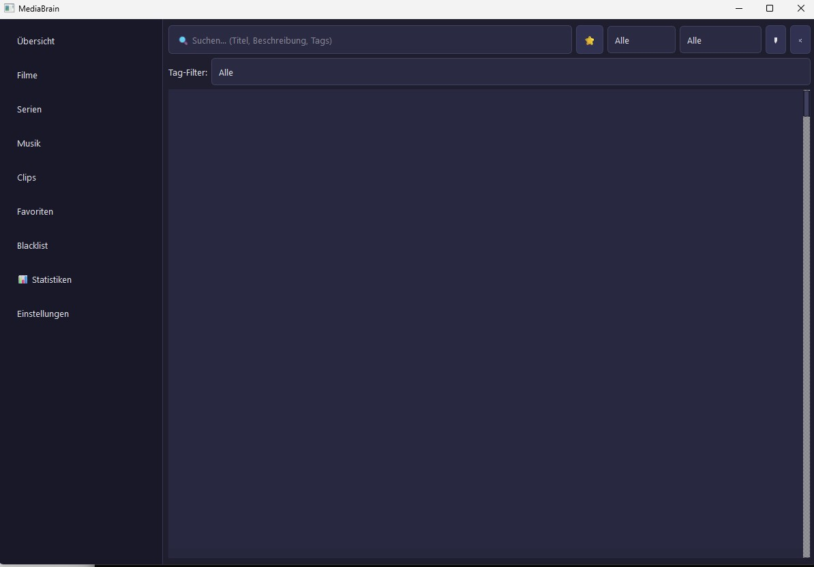

# MediaBrain

[](version.py)
[](LICENSE)
[](https://www.python.org/)
[]()
[]()
[]()
[](https://github.com/doc-bricks)
[](https://github.com/open-bricks)
[](llms.txt)

> **MediaBrain — менеджер медиатеки на PySide6, который в первую очередь хранит данные локально и помогает управлять личными видео, музыкой, плейлистами и историей просмотров в стриминговых сервисах.**

> [!NOTE]
> **Контекст для ИИ и агентов**: машиночитаемая архитектура репозитория, индексы файлов, поисковые фразы и границы системы описаны в [llms.txt](llms.txt).

[English](README.md) | [Deutsch](README_de.md) | **Русский** | [Конфиденциальность](PRIVACY_POLICY.md) | [Участие в проекте](CONTRIBUTING.md) | [История изменений](CHANGELOG.md)



## Языки документации

| Язык | Документ |
|---|---|
| English | [README.md](README.md) |
| Deutsch | [README_de.md](README_de.md) |
| Español | [README_es.md](README_es.md) |
| 简体中文 | [README_zh.md](README_zh.md) |
| 日本語 | [README_ja.md](README_ja.md) |
| Русский | [README_ru.md](README_ru.md) |

В таблице перечислены только языковые версии документации README. Она не описывает поддержку языков в приложении во время выполнения.

## Начните здесь

| Что нужно | Перейти к |
|---|---|
| Запустить настольное приложение | `python MediaBrain.py` |
| Посмотреть мобильную версию на Flutter | `flutter_port/README.md` |
| Узнать об ограничениях приватности | [PRIVACY_POLICY.md](PRIVACY_POLICY.md) |
| Разобраться в архитектуре | [ARCH.md](ARCH.md) |
| Посмотреть запланированные работы | [ROADMAP.md](ROADMAP.md) |
| Получить машиночитаемый контекст | [llms.txt](llms.txt) |

## Для чего нужен MediaBrain

MediaBrain предназначен для тех, кто хочет хранить в одном локальном месте медиа, которые смотрит, собирает, помечает тегами, заносит в чёрный список или организует по разным сервисам и локальным файлам. Это не стриминговый сервис, который размещает медиаконтент для пользователей, и приложение не загружает личную медиатеку в облачную учётную запись.

- Локальная база SQLite для медиазаписей, избранного, тегов, элементов чёрного списка и плейлистов
- Настольный интерфейс PySide6: панель, библиотеки, поиск, статистика, настройки и темы с высокой контрастностью
- Слой провайдеров для Netflix, YouTube, Spotify, Disney+, Prime Video, Apple TV+, Twitch и локальных файлов
- Обычные плейлисты и умные плейлисты на основе правил QueryBuilder
- Необязательный поиск метаданных по настроенным пользователем ключам TMDb/OMDb или общедоступным данным MusicBrainz
- Нет телеметрии, слежения и автоматической синхронизации с облаком

## Поисковый контекст

Этот репозиторий — каноническая страница GitHub для:

- `doc-bricks MediaBrain`
- `MediaBrain media library manager`
- `private SQLite media library manager`
- `local-first PySide6 media manager`
- `PySide6 smart playlist media manager`
- `offline media hub with smart playlists`
- `desktop media history tracker`
- `privacy-first media history desktop app`

Название «MediaBrain» совпадает с названиями компаний по аналитике медиа, лабораторий ИИ в области медиа и общих инструментов медиапланирования. Этот репозиторий посвящён именно локальному настольному менеджеру медиатеки `doc-bricks/MediaBrain`, а не облачной платформе рекламной аналитики, лаборатории мультимедийных исследований или генератору медиа на основе ИИ.

## Архитектура

```text
Core Layer        Database, MediaManager, BlacklistManager, TagManager, PlaylistManager
Query Layer       QueryBuilder for advanced filters and smart playlists
Provider Layer    Netflix, YouTube, Spotify, Disney+, Prime, AppleTV+, Twitch, Local
Background Layer  FileIndexer, WindowWatcher
GUI Layer         Dashboard, Libraries, Favorites, Blacklist, Playlists, Search, Stats, Settings
```

Полная схема: [ARCH.md](ARCH.md)

## Экосистема и смежные инструменты

MediaBrain входит в набор инструментов для документов и продуктивности [`doc-bricks`](https://github.com/doc-bricks), который развивается под зонтичным брендом [`open-bricks`](https://github.com/open-bricks):

| Инструмент | Назначение | Репозиторий |
|---|---|---|
| **MediaBrain** | Локальная история медиа, умные плейлисты и управление медиатекой | [doc-bricks/MediaBrain](https://github.com/doc-bricks/MediaBrain) |
| **CleanMarkdown** | Нормализация типографики, очистка Markdown и экспорт в PDF | [doc-bricks/CleanMarkdown](https://github.com/doc-bricks/CleanMarkdown) |
| **PDFtoPDFocr** | OCR-процесс для поиска текста в PDF и извлечения метаданных | [doc-bricks/PDFtoPDFocr](https://github.com/doc-bricks/PDFtoPDFocr) |
| **llm-note** | Локальный блокнот на SQLite и обычных текстовых файлах для личных заметок или заметок агентов | [doc-bricks/llm-note](https://github.com/doc-bricks/llm-note) |
| **LaunchBoards** | Визуальный лаунчер, органайзер приложений и рабочая панель | [file-bricks/LaunchBoards](https://github.com/file-bricks/LaunchBoards) |
| **ProFiler** | Анализатор и инспектор файлов с акцентом на приватность и поиском дубликатов | [file-bricks/ProFiler](https://github.com/file-bricks/ProFiler) |
| **KnowledgeDigest** | Офлайн-база знаний и средство сжатия документации | [file-bricks/KnowledgeDigest](https://github.com/file-bricks/KnowledgeDigest) |
| **WinStorePackager** | Упаковка MSIX, подготовка манифестов Store и создание ресурсов | [file-bricks/WinStorePackager](https://github.com/file-bricks/WinStorePackager) |
| **DevCenter** | Панель разработчика для нескольких репозиториев, монитор CI и менеджер рабочих пространств | [dev-bricks/DevCenter](https://github.com/dev-bricks/DevCenter) |
| **open-bricks** | Единый портал для настольных приложений и инструментов CLI | [open-bricks/open-bricks](https://github.com/open-bricks/open-bricks) |

## Установка

Требования:

- Python 3.10 или новее
- Windows, Linux или macOS с поддержкой Qt/PySide6

```bash
pip install -r requirements.txt
```

При первом запуске MediaBrain локально создаёт файл `settings.json`. Публичный шаблон — [settings.example.json](settings.example.json). Личные настройки, базы данных, журналы и артефакты сборки исключены через `.gitignore`.

## Использование

```bash
python MediaBrain.py
```

Доступ к командной строке только для чтения (записи в базу данных не выполняются):

```bash
python cli.py list
python cli.py search "title"
python cli.py --db /path/to/media_brain.db types
```

CLI скрывает элементы из чёрного списка. Чтобы явно выбрать базу данных, задайте `MEDIABRAIN_DB` или используйте `--db`.

Лаунчер Windows для запуска двойным щелчком:

```bat
START.bat
```

Лёгкий лаунчер для Windows можно собрать командой:

```bat
build_exe.bat
```

## Тесты

```bash
python -m pytest tests/ -q
```

Набор тестов охватывает менеджеры баз данных, метаданные, теги, QueryBuilder, плейлисты и работу интерфейса плейлистов в режиме offscreen.

Специализированный платформенный smoke-тест проверяет пути Unicode, конфигурацию, обмен JSON, системное открытие файлов и жизненный цикл окна и трея в режиме offscreen:

```bash
python -m pytest tests/source_platform_smoke.py -q
```

GitHub Actions запускает этот узконаправленный smoke-тест в Ubuntu и macOS. Он проверяет исходный код и контракт GUI в режиме offscreen, но не подтверждает нативную упаковку, работу трея в настольной сессии или ручную приёмку на любой из этих платформ.

## Конфиденциальность

MediaBrain хранит данные об использовании локально в базах SQLite и файлах конфигурации. Телеметрии и автоматической синхронизации с облаком нет. Необязательные запросы метаданных используют только настроенные пользователем ключи API TMDb/OMDb или общедоступные данные MusicBrainz. Подробнее: [PRIVACY_POLICY.md](PRIVACY_POLICY.md).

## Лицензия

Лицензия MIT, см. [LICENSE](LICENSE). Лицензии прямых сторонних зависимостей времени выполнения и разработки перечислены в [THIRD_PARTY_LICENSES.txt](THIRD_PARTY_LICENSES.txt). На PySide6, используемый в GUI, распространяются условия LGPL.

## Ответственность

Проект предоставляется бесплатно и «как есть», без каких-либо гарантий, обязательств по его сопровождению и гарантий пригодности для конкретной цели. Используйте его на свой риск.
